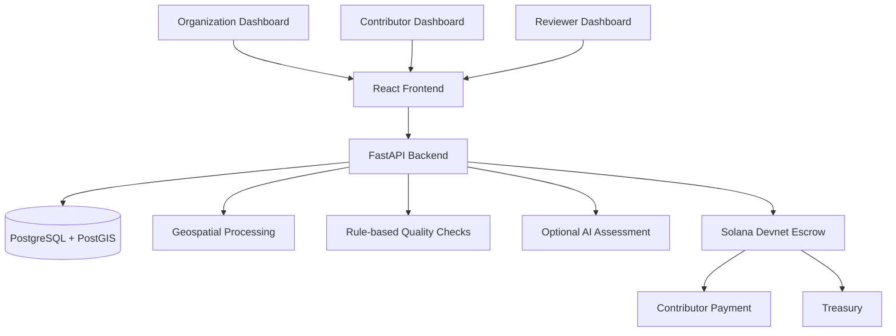

# FieldMint

> **Ground-truth infrastructure for agriculture and Earth Observation in Africa.**

FieldMint connects organizations that need reliable field-level data with contributors who collect observations on the ground. It combines geospatial task allocation, structured field-data collection, automated quality checks, human verification and transparent blockchain-based payments.

Built with a Kenya-first approach, FieldMint uses **Solana escrow** to make campaign funding and approved contributor payments traceable.

**Live platform:** [https://fieldmint.vercel.app](https://fieldmint.vercel.app)  
**API:** [https://fieldmint-api.onrender.com](https://fieldmint-api.onrender.com)  
**API documentation:** [https://fieldmint-api.onrender.com/docs](https://fieldmint-api.onrender.com/docs)  
**Network:** Solana Devnet

---

## The problem

Earth Observation and satellite imagery provide valuable information about agricultural land, environmental conditions and changes across landscapes. However, satellite data alone cannot always establish what is happening at a specific field location.

Organizations conducting agricultural programmes, research, environmental monitoring and geospatial analysis often need reliable observations collected directly on the ground.

This creates several challenges:

- Collecting geographically distributed field observations is operationally demanding.
- Field data can be inconsistent, incomplete or difficult to verify.
- Organizations need to connect observations to precise geographic locations.
- Contributors need transparent and accountable compensation.
- Payment and verification processes can be fragmented across different systems.

FieldMint addresses this gap by connecting geospatial data collection, quality assurance and accountable payments in one platform.

## What FieldMint does

FieldMint provides a coordinated workflow between three primary participants:

1. **Organizations** define data-collection campaigns, geographic areas, observation targets and contributor rewards.
2. **Contributors** collect and submit field observations at assigned geographic sampling points.
3. **Reviewers** examine submitted evidence, evaluate quality checks and make approval or rejection decisions.

Solana provides the payment infrastructure, while PostGIS supports the spatial data operations that connect campaigns, tasks and observations to geographic locations.

## How it works

### 1. Campaign creation

An organization creates a campaign, selects a target county and defines the required observations, reward amounts and campaign deadline.

FieldMint uses county boundaries and geospatial sampling to generate observation points within the selected campaign area.

### 2. Campaign funding

The organization funds the campaign through a Solana Devnet escrow transaction.

The escrow holds the allocated contributor rewards and platform fees under predefined program rules.

### 3. Field-data collection

Contributors access available campaigns, identify nearby sampling points and claim tasks.

A submission can include:

- GPS coordinates and location information.
- A field photograph.
- Crop type.
- Growth stage.
- Observed condition.
- Additional notes.
- Capture and GPS metadata.

### 4. Evidence quality assessment

FieldMint performs rule-based validation checks to help identify incomplete or potentially problematic submissions.

An AI-assisted assessment component is designed to provide additional advisory observations about submitted evidence. AI is not the final authority on submission validity.

### 5. Human review

Reviewers examine the submitted information, compare it with the campaign requirements and make the final decision.

They can approve a submission or reject it with a reason. Contributors cannot review their own submissions.

### 6. On-chain payment

When a submission is approved, the authorized reviewer initiates the payout.

The Solana escrow program releases the fixed contributor reward and the corresponding platform fee, and records an on-chain payment receipt.

This creates a traceable relationship between an approved submission and its payment.

---

## Platform dashboards

FieldMint is organized around three primary dashboards.

| Dashboard | Primary responsibilities |
|---|---|
| Organization | Campaign creation, geographic targeting, funding, campaign monitoring and escrow visibility |
| Contributor | Campaign discovery, task claiming, field-data collection, submissions and earnings |
| Reviewer | Submission inspection, quality assessment, approval, rejection and payment release |

Each dashboard supports a distinct part of the data-collection and verification workflow.

---

## Geospatial infrastructure

Geography is central to FieldMint rather than simply being a map displayed alongside the application.

The platform uses PostgreSQL with PostGIS to manage spatial entities and relationships.

Current geospatial capabilities include:

- Kenya's 47 county boundaries.
- Priority launch areas covering six counties.
- Campaign areas represented using geographic geometry.
- Sampling-point generation within campaign boundaries.
- Task and submission coordinates.
- Spatial validation of submitted observations against campaign areas.
- Distance-based checks between assigned sampling points and submitted locations.

The initial geographic focus is Kenya, with an architecture intended to support expansion across African agricultural and Earth Observation use cases.

## Solana escrow architecture

FieldMint uses a custom Solana program built with Anchor and deployed to Devnet.

**Program ID:**

`FFPqgWfSXD16jCwqppxFCi8G8BmEsU6p7kPZaAGs6Rcq`

[View the program on Solana Explorer](https://explorer.solana.com/address/FFPqgWfSXD16jCwqppxFCi8G8BmEsU6p7kPZaAGs6Rcq?cluster=devnet)

### Core program instructions

| Instruction | Purpose |
|---|---|
| `create_campaign` | Creates a campaign escrow and locks the allocated rewards and fees |
| `payout` | Releases an approved contributor reward and platform fee while creating a payment receipt |
| `close_campaign` | Allows the organization to reclaim eligible unspent campaign funds after the applicable conditions are met |

### On-chain safeguards

The escrow program is designed to enforce:

- Authorization of the designated reviewer.
- Fixed reward and fee amounts established at campaign creation.
- Prevention of duplicate payments through submission-specific receipt accounts.
- Limits on payouts based on the funded campaign allocation.
- Payment of platform fees to the designated treasury.
- Restrictions on early withdrawal of campaign funds.
- A maximum platform fee of 20%.

### On-chain and off-chain data

FieldMint separates payment verification from the storage of field evidence.

**On-chain:**
- Campaign escrow state.
- Payment transactions.
- Payment receipts.
- Submission fingerprints used to associate payments with specific records.

**Off-chain:**
- Photographs.
- GPS coordinates.
- Contributor information.
- Crop observations.
- Notes and other submission details.

The submission fingerprint uses SHA-256 to provide a link between a specific record and its corresponding payment without publishing the underlying field evidence on the blockchain.

---

## AI-assisted quality assessment

AI is intended to support the evidence-review process rather than replace it.

The assessment component is designed to help reviewers examine:

- Whether submitted photographs are relevant to the declared observation.
- Whether visible crop characteristics are consistent with submitted information.
- Whether the submitted details contain inconsistencies.
- Whether the available evidence is sufficiently clear for review.
- Which aspects may require additional human attention.

AI assessments are advisory. They do not independently approve, reject or authenticate field observations.

Rule-based checks and human review remain distinct from AI-generated assessments.

**Deployment status:** The current hosted deployment does not have an external AI provider configured. The AI assessment should therefore be treated as an optional development component, not an active capability of the live demo.

---

## Current implementation status

FieldMint is an early-stage hackathon prototype running on Solana Devnet.

| Capability | Status |
|---|---|
| Organization, contributor and reviewer dashboards | Implemented |
| Wallet-signature authentication and role-based access | Implemented |
| Kenya county boundaries (47 counties) | Implemented |
| Priority launch counties | Implemented |
| Geographic sampling-point generation | Implemented |
| Campaign creation and management | Implemented |
| Solana Devnet escrow funding | Implemented |
| On-chain campaign funding verification | Implemented |
| Contributor task claiming | Implemented |
| GPS-enabled field submissions | Implemented |
| Photograph and crop-observation submission | Implemented |
| Rule-based submission checks | Implemented |
| Human approval and rejection workflow | Implemented |
| Solana payout and submission-specific receipts | Implemented |
| On-chain earnings and escrow information | Implemented |
| AI-assisted assessment | Optional; enabled in the current hosted deployment |
| CSV and GeoJSON dataset exports | Planned |
| Advanced campaign analytics | Planned |
| USDC settlement | Planned |
| M-Pesa cash-out through a licensed partner | Planned |
| Offline collection and SMS tasking | Planned |
| Embedded wallets and phone-based onboarding | Planned |
| Multisignature reviewer authorization | Planned |
| Independent smart-contract security audit | Planned |

---

## Technology stack

| Layer | Technologies |
|---|---|
| Frontend | React 19, TypeScript, Vite |
| Styling | Tailwind CSS 4 |
| Routing | React Router |
| Mapping | Leaflet, React Leaflet |
| Wallet integration | Solana React Hooks, Solana Kit |
| Backend | Python, FastAPI |
| Database access | SQLAlchemy |
| Geospatial processing | PostGIS, GeoAlchemy2, Shapely |
| Database | PostgreSQL |
| Blockchain | Solana Devnet, Anchor, Rust |
| Authentication | Wallet-signature authentication, JWT |
| Infrastructure | Docker, Docker Compose |
| Frontend hosting | Vercel |
| Backend hosting | Render |
| Database hosting | Neon |

---

## System architecture



The backend coordinates campaign operations, geospatial processing, submission validation and reviewer workflows. Solana handles escrow and payment operations, while PostgreSQL and PostGIS manage application and geographic data.

---

## Repository structure

```text
fieldmint/
├── src/
│   ├── components/
│   ├── pages/
│   ├── lib/
│   └── ...
│
├── backend/
│   ├── app/
│   │   ├── main.py
│   │   ├── auth.py
│   │   ├── db.py
│   │   ├── models.py
│   │   ├── escrow.py
│   │   ├── tasks.py
│   │   ├── ai.py
│   │   ├── ledger.py
│   │   └── data/
│   │       └── kenya_counties.geojson
│   ├── Dockerfile
│   ├── requirements.txt
│   └── .env.example
│
├── escrow/
│   └── programs/
│       └── escrow/
│
├── docker-compose.yml
├── vercel.json
├── package.json
└── README.md
```

---

## Getting started

### Prerequisites

To run the project locally, you need:

- Node.js 20 or later.
- npm.
- Docker and Docker Compose.
- A Solana wallet such as Phantom or Solflare.
- A wallet configured for Solana Devnet.

The existing escrow program is already deployed to Devnet, so running the frontend and backend does not require rebuilding the Solana program.

### 1. Clone the repository

```bash
git clone https://github.com/MechaImmaculate/fieldmint.git

cd fieldmint
```

### 2. Install frontend dependencies

```bash
npm install
```

### 3. Configure the backend

Copy the example environment file:

```bash
cp backend/.env.example backend/.env
```

Edit `backend/.env` and supply the required database, authentication and Solana configuration.

Do not commit `.env` files, private keys, wallet keypairs or other credentials.

### 4. Start the backend and database

```bash
docker compose up -d --build
```

The Docker Compose configuration starts the PostgreSQL/PostGIS database and FastAPI backend.

The application initialises its database schema and seeds the county regions during startup.

### 5. Configure the frontend

Create a root `.env` file:

```bash
echo 'VITE_API_URL=http://localhost:8000' > .env
```

### 6. Start the frontend

```bash
npm run dev
```

Open:

[http://localhost:5173](http://localhost:5173)

### 7. Verify the backend

Health endpoint:

[http://localhost:8000/health](http://localhost:8000/health)

API documentation:

[http://localhost:8000/docs](http://localhost:8000/docs)

---

## Environment configuration

The backend reads configuration from environment variables.

| Variable | Purpose |
|---|---|
| `DATABASE_URL` | PostgreSQL connection string |
| `JWT_SECRET` | Secret used for authentication tokens |
| `ORG_WALLETS` | Comma-separated organization wallet addresses |
| `REVIEWER_WALLETS` | Comma-separated reviewer wallet addresses |
| `ESCROW_ADDRESS` | Escrow configuration address |
| `SOLANA_RPC` | Solana RPC endpoint |
| `PROGRAM_ID` | Deployed Solana escrow program ID |
| `TREASURY_ADDRESS` | Platform fee recipient |
| `FEE_BPS` | Platform fee in basis points; 500 represents 5% |
| `UPLOAD_DIR` | Location for uploaded submission files |
| `CORS_ORIGINS` | Permitted frontend origins |
| `PORT` | Backend service port |

The frontend uses:

| Variable | Purpose |
|---|---|
| `VITE_API_URL` | Base URL of the FastAPI backend |

For local development, the default Solana RPC endpoint is:

`https://api.devnet.solana.com`

Use the supplied `.env.example` as the reference for the current configuration.

---

## Deployment

FieldMint currently uses a three-part hosted architecture.

| Component | Hosting provider | Deployment |
|---|---|---|
| Frontend | Vercel | [fieldmint.vercel.app](https://fieldmint.vercel.app/) |
| Backend API | Render | [fieldmint-api.onrender.com](https://fieldmint-api.onrender.com/) |
| PostgreSQL/PostGIS | Neon | Connected to the hosted backend |

The frontend communicates with the backend through the `VITE_API_URL` environment variable.

The backend uses `DATABASE_URL` to connect to Neon and `CORS_ORIGINS` to control permitted frontend origins.

The API health endpoint is available at `/health`.

---

## Limitations and considerations

FieldMint is a prototype intended for demonstration and further validation. It is not yet a production-ready agricultural data infrastructure service.

Important limitations include:

- **Devnet deployment:** All current blockchain transactions use Solana Devnet, not mainnet.
- **Unaudited smart contract:** The escrow program has not undergone an independent security audit.
- **Reviewer trust:** The designated reviewer is an authorized participant in the payment process. More advanced reviewer governance is planned.
- **AI limitations:** AI-generated assessments can be inaccurate and must not replace human judgement.
- **Geospatial verification:** GPS and rule-based checks provide useful quality signals but cannot independently prove that a field observation is genuine.
- **Storage:** The current prototype uses application-side file storage. Persistent, production-grade object storage is still needed.
- **Authentication state:** Some prototype authentication state is held in application memory and requires more robust production infrastructure.
- **No fiat cash-out:** M-Pesa settlement is not currently implemented.
- **Production security:** Additional access controls, monitoring, rate limiting, privacy safeguards and security testing are required before handling real campaign data and funds.

The project should be tested with appropriate demonstration data and Devnet assets. Do not use the prototype to manage real-world campaign funds or sensitive field information.

---

## Roadmap

FieldMint's next development priorities include:

1. Strengthen geospatial validation and evidence-quality workflows.
2. Improve persistent storage and production security.
3. Expand organization-level campaign analytics.
4. Support structured CSV and GeoJSON dataset exports.
5. Improve AI-assisted reviewer support while preserving human decision-making.
6. Explore stablecoin-based settlement.
7. Investigate M-Pesa integration through an appropriate licensed partner.
8. Develop offline-first collection and SMS-based workflows.
9. Introduce multisignature reviewer governance and independent security auditing.
10. Expand beyond the initial Kenyan launch areas into wider African agricultural and Earth Observation use cases.

---

## Vision

FieldMint aims to make field-level ground truth more accessible, geographically structured and accountable.

By connecting organizations, local contributors, geospatial technology and transparent payment infrastructure, the platform seeks to strengthen the relationship between what satellite systems observe and what is actually happening on the ground.

The long-term ambition is to build infrastructure that supports reliable agricultural and Earth Observation data collection across Africa.

---

## Acknowledgements

FieldMint builds on open-source and ecosystem technologies including:

- [Solana](https://solana.com/)
- [Anchor](https://www.anchor-lang.com/)
- [FastAPI](https://fastapi.tiangolo.com/)
- [PostgreSQL](https://www.postgresql.org/)
- [PostGIS](https://postgis.net/)
- [GeoAlchemy2](https://geoalchemy-2.readthedocs.io/)
- [React](https://react.dev/)
- [Vite](https://vite.dev/)
- [Leaflet](https://leafletjs.com/)
- [geoBoundaries](https://www.geoboundaries.org/)

Built by [Immaculate Mecha](https://github.com/MechaImmaculate). 

**FieldMint — Ground truth that can be verified, reviewed and accounted for.**
